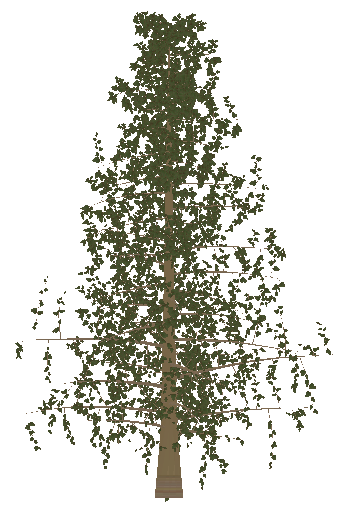

# Plan: procedural tree billboard textures from SeedThree

Status: **plan + proof of concept** (harness in `misc/tree_billboards/poc/`, samples in
`docs/dev/tree_billboards_samples/`). No production pipeline code yet, nothing in Java changed.

## Decisions (agreed with the maintainer, 2026-11-25)

* **Coverage:** species/genus-specific rules only where the SeedThree preset is a fair stand-in;
  the three existing `tree_00{0,1,2}.png` stay as the `leaf_type` fallbacks. Authoring new European
  species presets upstream is a separate, later track — not part of this work.
* **Crossed quads:** front view only, baked once and shared by both rectangles — no Java change.
* **Resolution:** 512 px tall (house convention, ~1.4 MB with mips per texture).
* **Licensing:** derivative-of-MIT (SeedThree textures, themselves image-model generated by its
  authors) is acceptable; provenance must be recorded in the `AssetListTest` master asset list
  (SeedThree, MIT, imagegen note) and reviewed in `docs/ASSET-LIST.md`.

## Goal

Replace / complement the three hand-picked tree textures
(`src/main/resources/textures/trees/tree_00{0,1,2}.png`, drawn by `MesherBillboard` as two
crossed alpha-tested quads) with textures generated by the procedural generator
[SeedThree](https://github.com/SkyeShark/SeedThree) (local checkout `D:\src\SeedThree`), for
those plant species SeedThree actually knows. Generation lives in the `misc` data pipeline;
the plugin stays data-driven and lightweight, no Java rework.

## Key finding: no patch to SeedThree is needed

SeedThree already has everything we need, twice over:

* **Headless API** — `src/api/seedthree.js`: `createTree({species, seed, controls, lod, loadTexture,
  assetsDir, level:'LOD0'})` grows the exact same plant the browser app shows (same presets, same
  `buildTree`), and `generate()` runs with no GPU for shape/stat work.
* **Render-to-texture bake** — `src/core/impostor.js: bakeGroupToTextures(renderer, sourceRoot, views, opts)`.
  It is generic (we supply our own cameras), it clears with `alpha 0`, it preserves each material's
  alpha cutout, it returns **raw RGBA pixels** (`{rawPixels: true}`), applies alpha-edge dilation,
  and converts linear→sRGB for the albedo channel. That is exactly "transparent raster of a chosen
  resolution". SeedThree itself uses it for its billboard LOD (`bake-worker.js`).

So the "does it emit a transparent raster of given size?" suspicion is **yes**; the upstream patch
idea is not needed. Only nice-to-have PRs (see last section).

## Proof of concept (verified on this machine, 2026-11-25)

Harness: Node 22 → tiny static server rooted at the SeedThree checkout →
headless Chrome 158 (`--headless=new --remote-debugging-port`) driven over raw CDP →
in-page ES modules with an import map (`three/webgpu`, `three/tsl`, `lil-gui` mapped to
`node_modules`) → `createTree()` + `bakeGroupToTextures()` → RGBA back to Node → `sharp` (already a
SeedThree devDependency) crops/encodes PNG.

* Headless Chrome on this box has a **real WebGPU adapter** (no fallback adapter;
  `maxTextureDimension2D = 16384`), and RT readback returns RGBA with `alpha = 0` background.
* Baked `redMaple` seed 7 and `douglasFir` seed 3 at 512:
  * alpha histogram is strictly binary: 0 or 255, no intermediate values → matches the plugin's
    `glAlphaFunc(GL_GREATER, 0.5)` in `Renderer3D.drawTextureQuad`;
  * output is **non-square and aspect-correct**: 463×512 (maple, 0.90) and 338×512 (fir, 0.66),
    same convention as the current assets (tree_000 512×512, tree_001 356×512, tree_002 431×512 —
    texture aspect equals the MapCSS `width`/`height` ratio);
  * cost: 0.66 s per species for 2 views × 4 channels at 512 (≈3 s at 1024) → a full 20-species
    sweep with seed variants is minutes, so seed selection by eye is cheap.
* Quality warning, confirmed by the samples: not every species/seed reads well as a distant card.
  `redMaple` seed 7 is dense and clean; `douglasFir` seed 3 came out sparse with bare whip twigs
  visible. Seed choice (and a few LOD/branch knobs) must be curated per species, not defaulted.

  Samples (baked at 512 px tall, transparent background as baked; front view unless noted):

  | redMaple, seed 7 — 463×512 | redMaple, seed 7, side view — 463×512 | douglasFir, seed 3 — 338×512 |
  |---|---|---|
  |  |  |  |

  Note the side view of the same seed: silhouette differs, which is why crossed quads would really
  want two textures (see *Crossed quads*); with one shared card we accept the front silhouette at 90°.
* The bake light is hardcoded (`HemisphereLight` white ×3.0), so bark comes out pale/grey-ish. For
  our *unlit* textured quads we would prefer a flatter, slightly darker bake: colour-grade with
  `sharp` (no SeedThree change), or PR a `opts.lightIntensity` (one line).

## Proposed pipeline layout (`misc/tree_billboards/`)

```
misc/tree_billboards/
  poc/                     <- the validated POC harness (poc.html, run-poc.mjs), to be replaced by:
  bake-page.html           <- in-page bake: import map + SeedThree api + impostor; exposes window.__bake()
  bake.mjs                 <- Node driver: static server, headless Chrome spawn, CDP eval,
                              RGBA -> sharp (crop / grade / resize) -> PNG + bake-manifest.json
  species_map.json         <- the contract with the plugin data: SeedThree species key ⇄ normalized OSM
                              species/genus names ⇄ chosen seed ⇄ LOD knobs ⇄ resolution ⇄ attribution
  make_tree_billboards.py  <- misc entry point (Python-first, `pylint -E` clean): reads
                              data/tree_species.csv + species_map.json, calls node bake.mjs,
                              writes PNGs and the generated MapCSS block, writes a contact-sheet report
```

SeedThree stays an **external tool** (not vendored): its path comes from `SEEDTHREE_DIR`
(same convention SeedThree's own `render-eidoverse-tree.ps1` uses). Requirements to run the bake
(Chrome + `npm install` in SeedThree) documented in `misc/AGENTS.md`; the generated PNGs are
committed, so `mvn package` never needs Chrome.

## The validated bake recipe

1. `createTree({species, seed, level: 'LOD0', loadTexture})` with a real `TextureLoader`-based
   `loadTexture` (the api's contract is `(path,{srgb}) => Promise<Texture|null>`), `setWind({strength: 0})`
   so the raster is a still tree.
2. Framing: orthographic camera **centred on the trunk axis** (`x=0, z=0`, y = bbox mid) — this is the
   same rule SeedThree's own bake worker uses to keep crossed cards' trunks aligned — with an
   **isotropic square frustum** `iso = max(halfW, halfH)` where `halfW/halfH` are the bbox halves ×1.03.
   Square pixels + the caller-chosen square RT = no anisotropic stretch; then `sharp.extract()` crops
   to `size·halfW/iso × size·halfH/iso`, giving a tight, aspect-correct, non-square PNG **without
   patching SeedThree** (cost: up to ~2× wasted pixels for narrow conifers).
3. Channels: keep **albedo** only. `normal`/`roughness`/`translucency` exist for SeedThree's runtime
   re-lighting; the plugin draws textured quads unlit (`glColor4d(1,1,1,1)` + `GL_ALPHA_TEST`), so the
   albedo card is all we consume. `dilate: 4` passes (SeedThree's default 12 is tuned for their mip chain).
4. Row order: `processPixels()` already flips the readback, so the returned array is top-row-first and
   `sharp` writes it directly (verified visually: trunk base at the bottom of the PNG).
5. Record in `bake-manifest.json`: species key, seed, SeedThree git rev, size, `halfW/halfH`, real
   metres, crop box, alpha histogram. The MapCSS `height`/`width` defaults come from `halfW/halfH`
   (margins cancel out, ratio = real crown width / real tree height), scaled to the plugin's height
   convention.

## Wiring it into the plugin (no Java rewrite)

* New textures under the existing folder: `textures/trees/tree_<species_key>.png`
  (e.g. `tree_red_maple.png`, `tree_apple.png`). The current three stay as the leaf-type fallbacks.
* Rules: `AssetConfigLoader` parses the single `/assets.mapcss` string, so the generated rules go into
  a delimited block appended **after** the generic `leaf_type` rules — with the same selector
  specificity, MapCSS resolves ties by source order, so the more specific species rule wins:

  ```css
  /* BEGIN GENERATED by misc/tree_billboards/make_tree_billboards.py — do not edit by hand */
  node[natural=tree][species="Malus domestica"] {
      billboard: "/textures/trees/tree_apple.png";
      height: 6; width: 5.2;
  }
  /* END GENERATED */
  ```

  Genus stand-ins use the regex form (`[species=~"^Quercus"]`), and the existing
  species normalization/`TreeSpeciesDatabase.enrichTags` path keeps working unchanged: an unmatched
  tree just falls back to `tree_000/001/002`.
* Registration only: `AssetListTest` master asset list gets new entries with provenance
  (SeedThree, MIT — see licensing note below); `docs/ASSET-LIST.md` regenerates from it. That is a data
  list edit, not Java logic. `SceneTest` keeps the three generic textures and stays green.

## Coverage: what SeedThree knows vs. what our OSM data has

Twenty species, Nearctic + North-American-desert biomes.

* Solid matches for us: **apple** (*Malus domestica*), **sweet cherry** (*Prunus avium*),
  **weeping willow** (*Salix babylonica*), and near-enough genus-level stand-ins:
  *American* sycamore for *Platanus × acerifolia*, paper birch for *Betula pendula*, quaking aspen
  for *Populus tremula*, white oak for *Quercus robur*, American beech for *Fagus sylvatica*,
  red maple for *Acer platanoides/pseudoplatanus*, tulip poplar/sweetgum as ornamental stand-ins.
* Weak or missing for the North-Eurasian flora the plugin actually renders: no **spruce** (*Picea
  abies*), no **Scots pine** (*Pinus sylvestris* — ponderosa/loblolly read differently), no **linden**,
  rowan, ash, elm, horse-chestnut; no palm at all, so `tree_002.png` is not reproducible with
  SeedThree. Desert presets (saguaro, Joshua tree, creosote, sagebrush, blackbrush) are a bonus for
  arid-region rendering and could later replace the shrub texture too.

Two directions, and they are not mutually exclusive:
**(A)** ship species/genus rules only where the preset is a fair stand-in, keep generic textures
elsewhere; **(B)** author new presets for European/North-Eurasian species — SeedThree's README
documents exactly that agent workflow (`src/species/<name>.js` + generated bark/leaf alpha cards,
"no engine changes"), so `Picea abies`, `Pinus sylvestris`, `Tilia cordata`, `Sorbus aucuparia`,
`Betula pendula`, `Quercus robur` are plausible upstream contributions. (B) needs an image generator
for bark/leaf cards, which is a separate decision.

## Crossed quads: one texture for both cards

`MesherBillboard` draws two crossed rectangles that share **one** texture. Options:

1. **Front view only** (zero Java change) — **chosen**: the same card from the front is reused at 90°.
   Simple, and what the current OSM2World textures effectively do.
2. **Multi-view average into one card** (zero Java change, bake-side): bake 4 views (0°/45°/90°/135°)
   and alpha-weighted-average them into a single rotation-stable "omnidirectional" card. Slightly
   softer silhouette, no 90°-view pop. Cheap to try since a bake is sub-second; compare visually.
3. **Two textures** (front + side, exactly like SeedThree's own impostor): the most faithful, needs a
   small Java change (a second texture unit in `MesherBillboard`/`RenderableElement`/`TextureManager`).
   Defer; decide after (1)/(2) are seen in the 3D window.

## Rollout

1. ~~Decide coverage / resolution / crossed-quad strategy~~ — done, see *Decisions* above.
2. Promote the POC into `bake-page.html` + `bake.mjs` + `species_map.json`, add a **contact-sheet mode**:
   bake N seeds per species at 256 into one `docs/tree_billboards.md` grid so seed choice is one glance.
3. Human picks seeds/knobs; regenerate final PNGs at the chosen resolution + the MapCSS block.
4. `AssetListTest` master list + provenance → `mvn package` → manual test in the 3D window
   (single tree, forest polygons, mixed forest, `diameter_crown`/`height` tag override paths) →
   DEVBLOG + `docs/features.md`.
5. Optional upstream: issue/PR (below) and, if we go with (B), new species presets.

## Optional SeedThree PRs (not required by us)

* Non-square / tightly-framed render target in `bakeGroupToTextures` (we currently work around it with
  an isotropic frustum + crop; conifers waste up to ~2× pixels).
* `opts.lightIntensity` / `opts.scene` for the bake instead of the hardcoded `HemisphereLight ×3.0`.
* Export a `viewsFromBox()` helper so callers do not re-derive trunk-axis framing (front/side, and
  arbitrary azimuths for the multi-view option above).

## Risks / constraints

* **Host for the bake**: needs Chrome/Edge with working WebGPU (headless on Windows uses D3D/WARP; verified
  here on RTX 4070 Ti / A2000). A CI job for this would need a GPU or a software adapter; keep the bake
  a pre-release/offline step like the rest of `misc`, and commit the outputs.
* **Provenance**: SeedThree is MIT; its bark/leaf textures were themselves generated by its authors
  with an image model (`$imagegen`). Our billboards are derivative works of those textures → the
  attribution entry in `AssetListTest` must say so, and the license chain should be reviewed once
  before we ship them (the plugin's current tree assets are CC0).
* **RAM**: each 512-tall RGBA card ≈ 1 MB, ×1.33 with mipmaps. 20 species ≈ 28 MB resident in
  `TextureManager` — acceptable, but it argues for 512 rather than 1024 until the LRU eviction idea in
  AGENTS.md lands.
* **OSM species-tag noise**: species-specific rules multiply the effect of misspelled/unknown values;
  reuse the pipeline's POWO-based normalization and keep genus rules conservative.
