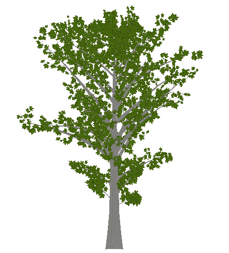
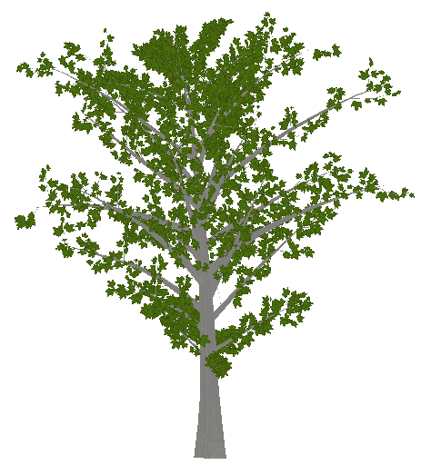

# Plan: procedural tree billboard textures from SeedThree

Status: **shipped through promotion** (2026-11-26): bake 80/80 OK (20 presets × 4 variants @ 512 px),
Makefile target promotes `assets_trees.mapcss` + `*_01.png` into plugin resources, `AssetListTest`
lists all 20 textures with provenance, `mvn package` green. Remaining: manual test in the 3D window
by the maintainer (`tests/tree_species_billboards.osm`), and decisions on the coverage gaps
(`docs/seedthree_coverage.md`).

## Decisions (agreed with the maintainer, 2026-11-25, amended 2026-11-26)

* **Coverage:** species/genus-specific rules only where the SeedThree preset is a fair stand-in;
  the three existing `tree_00{0,1,2}.png` stay as the `leaf_type` fallbacks. Authoring new European
  species presets upstream is a separate, later track — not part of this work.
* **Crossed quads:** front view only, baked once and shared by both rectangles — no Java change.
* **Resolution:** 512 px tall (house convention, ~1.4 MB with mips per texture).
* **Licensing:** derivative-of-MIT (SeedThree textures, themselves image-model generated by its
  authors) is acceptable; provenance must be recorded in the `AssetListTest` master asset list
  (SeedThree, MIT, imagegen note) and reviewed in `docs/ASSET-LIST.md`.
* **Seed strategy (amended 2026-11-26):** no manual seed curation — it would not scale to hundreds
  of species. The pipeline bakes **4 variants per species** (seeds 1–4) at final quality; all four
  are shipped candidates for in-plugin diversity. A visibly defective individual is excluded with the
  `--ban specieskey:seed` flag (remaining variants renumber); the earlier
  `"banned_seeds"`-in-`species_map.json` idea was dropped along with that file.
  Using several variants per node is future small-plugin work: today's MapCSS references one
  texture per species, and `manifest.json` already carries per-variant sizes (aspect!) for later.
* **Outputs:** everything the pipeline produces goes to `misc/data/17_seedthree_textures/`
  (pipeline outputs always live in `misc/data`, sorted by stage): final transparent PNGs,
  `manifest.json` (provenance), the preliminary report `tree_billboards.md`, the generated
  `assets_trees.mapcss`, and `coverage.md`. No low-res contact-sheet previews; the single bake at
  512 px with alpha *is* the deliverable. Promotion into `src/main/resources/` is an explicit
  Makefile target (see Rollout 4), not an automatic side effect of the bake.
* **Naming:** textures are named after the preset's Latin binomial plus the variant number:
  `Quercus_alba_01.png`… The same file is the stand-in for *Quercus robur/petraea* via MapCSS —
  the texture shows the plant the preset grows, so it carries that name.

## Goal

Replace / complement the three hand-picked tree textures
(`src/main/resources/textures/trees/tree_00{0,1,2}.png`, drawn by `MesherBillboard` as two
crossed alpha-tested quads) with textures generated by the procedural generator
[SeedThree](https://github.com/SkyeShark/SeedThree) (local checkout `D:\src\SeedThree`), for
those plant species SeedThree actually knows. Generation lives in the `misc` data pipeline;
the plugin stays data-driven and lightweight, no Java rework.

## Key finding: no patch to SeedThree is needed

SeedThree already has everything we need, twice over:

* **Headless API** — `src/api/seedthree.js`: `createTree({species, seed, controls, lod, loadTexture,
  assetsDir, level:'LOD0'})` grows the exact same plant the browser app shows (same presets, same
  `buildTree`), and `generate()` runs with no GPU for shape/stat work.
* **Render-to-texture bake** — `src/core/impostor.js: bakeGroupToTextures(renderer, sourceRoot, views, opts)`.
  It is generic (we supply our own cameras), it clears with `alpha 0`, it preserves each material's
  alpha cutout, it returns **raw RGBA pixels** (`{rawPixels: true}`), applies alpha-edge dilation,
  and converts linear→sRGB for the albedo channel. That is exactly "transparent raster of a chosen
  resolution". SeedThree itself uses it for its billboard LOD (`bake-worker.js`).

So the "does it emit a transparent raster of given size?" suspicion is **yes**; the upstream patch
idea is not needed. Only nice-to-have PRs (see last section).

## Proof of concept (verified on this machine, 2026-11-25)

Harness: Node 22 → tiny static server rooted at the SeedThree checkout →
headless Chrome 158 (`--headless=new --remote-debugging-port`) driven over raw CDP →
in-page ES modules with an import map (`three/webgpu`, `three/tsl`, `lil-gui` mapped to
`node_modules`) → `createTree()` + `bakeGroupToTextures()` → RGBA back to Node → `sharp` (already a
SeedThree devDependency) crops/encodes PNG.

* Headless Chrome on this box has a **real WebGPU adapter** (no fallback adapter;
  `maxTextureDimension2D = 16384`), and RT readback returns RGBA with `alpha = 0` background.
* Baked `redMaple` seed 7 and `douglasFir` seed 3 at 512:
  * alpha histogram is strictly binary: 0 or 255, no intermediate values → matches the plugin's
    `glAlphaFunc(GL_GREATER, 0.5)` in `Renderer3D.drawTextureQuad`;
  * output is **non-square and aspect-correct**: 463×512 (maple, 0.90) and 338×512 (fir, 0.66),
    same convention as the current assets (tree_000 512×512, tree_001 356×512, tree_002 431×512 —
    texture aspect equals the MapCSS `width`/`height` ratio);
  * cost: 0.66 s per species for 2 views × 4 channels at 512 (≈3 s at 1024) → a full 20-species
    sweep with seed variants is minutes, so seed selection by eye is cheap.
* Quality warning, confirmed by the samples: not every species/seed reads well as a distant card.
  `redMaple` seed 7 is dense and clean; `douglasFir` seed 3 came out sparse with bare whip twigs
  visible. Seed choice (and a few LOD/branch knobs) must be curated per species, not defaulted.

  Samples (baked at 512 px tall, transparent background as baked; front view unless noted):

  | redMaple, seed 7 — 463×512 | redMaple, seed 7, side view — 463×512 | douglasFir, seed 3 — 338×512 |
  |---|---|---|
  |  |  |  |

  Note the side view of the same seed: silhouette differs, which is why crossed quads would really
  want two textures (see *Crossed quads*); with one shared card we accept the front silhouette at 90°.
* The bake light is hardcoded (`HemisphereLight` white ×3.0), so bark comes out pale/grey-ish. For
  our *unlit* textured quads we would prefer a flatter, slightly darker bake: colour-grade with
  `sharp` (no SeedThree change), or PR a `opts.lightIntensity` (one line).

## Pipeline layout (`misc/tree_billboards/`)

```
misc/tree_billboards/
  bake-page.html           <- in-page bake: import map + SeedThree api + impostor; exposes
                              window.__bake() and window.__speciesList()
  bake.mjs                 <- Node driver: static server, headless Chrome spawn, CDP eval,
                              RGBA -> sharp (crop) -> PNG + manifest.json; --list-species dumps
                              SeedThree's own species registry (key, English name, Latin, biome)
  make_tree_billboards.py  <- misc entry point (Python-first, `pylint -E` clean): asks SeedThree
                              which species it knows, bakes all of them (4 seeds; `--ban key:seed`
                              drops defective individuals), writes PNGs + report
  make_tree_assets.py      <- promotion rules: generates assets_trees.mapcss (exact Latin names +
                              synonyms from tree_synonyms.csv, width from manifest) between markers
  make_coverage_report.py  <- coverage.md: top-150 OSM species vs presets with thumbnails
```

There is deliberately **no species list here**: the species set and their Latin names are queried
from SeedThree itself (each preset carries `latin:`), so a new upstream preset automatically joins
the sweep. Texture⇄OSM-name mapping happens at promotion time: exact Latin binomials plus POWO
synonyms from the pipeline's `tree_synonyms.csv`. Stand-ins (near-species without a preset) remain
a separate future decision.

All pipeline output, intermediates included, is in `misc/data/17_seedthree_textures/` (the
`misc/data` convention): textures, `manifest.json`, `tree_billboards.md`, `coverage.md`,
`assets_trees.mapcss`, the `bake.milestone` stamp, and `intermediates/` (jobs.json, species.json,
Chrome profile). Nothing is written under `misc/tree_billboards/`. The coverage report is copied by
the same Makefile recipe to `docs/seedthree_coverage.md`; its image links are relative to the docs
location, so they are dead in the misc original by design.

SeedThree stays an **external tool** (not vendored): its path comes from `SEEDTHREE_DIR`
(same convention SeedThree's own `render-eidoverse-tree.ps1` uses). Requirements to run the bake
(Chrome + `npm install` in SeedThree) documented in `misc/AGENTS.md`; `mvn package` never needs
Chrome.

## The validated bake recipe

1. `createTree({species, seed, level: 'LOD0', loadTexture})` with a real `TextureLoader`-based
   `loadTexture` (the api's contract is `(path,{srgb}) => Promise<Texture|null>`), `setWind({strength: 0})`
   so the raster is a still tree.
2. Framing: orthographic camera **centred on the trunk axis** (`x=0, z=0`, y = bbox mid) — this is the
   same rule SeedThree's own bake worker uses to keep crossed cards' trunks aligned — with an
   **isotropic square frustum** `iso = max(halfW, halfH)` where `halfW/halfH` are the bbox halves ×1.03.
   Square pixels + the caller-chosen square RT = no anisotropic stretch; then `sharp.extract()` crops
   to `size·halfW/iso × size·halfH/iso`, giving a tight, aspect-correct, non-square PNG **without
   patching SeedThree** (cost: up to ~2× wasted pixels for narrow conifers).
3. Channels: keep **albedo** only. `normal`/`roughness`/`translucency` exist for SeedThree's runtime
   re-lighting; the plugin draws textured quads unlit (`glColor4d(1,1,1,1)` + `GL_ALPHA_TEST`), so the
   albedo card is all we consume. `dilate: 4` passes (SeedThree's default 12 is tuned for their mip chain).
4. Row order: `processPixels()` already flips the readback, so the returned array is top-row-first and
   `sharp` writes it directly (verified visually: trunk base at the bottom of the PNG).
5. Record in `bake-manifest.json`: species key, seed, SeedThree git rev, size, `halfW/halfH`, real
   metres, crop box, alpha histogram. The MapCSS `height`/`width` defaults come from `halfW/halfH`
   (margins cancel out, ratio = real crown width / real tree height), scaled to the plugin's height
   convention.

## Wiring it into the plugin (no Java rewrite)

* New textures under the existing folder: `textures/trees/<Latin_name>_<NN>.png`
  (e.g. `Quercus_alba_01.png`…`_04.png`; the variant number is a hook for future per-node variety
  in the plugin). The current three stay as the leaf-type fallbacks.
* Rules: `AssetConfigLoader` parses `/assets.mapcss` and then appends the optional
  `/assets_trees.mapcss` — with the same selector specificity, MapCSS resolves ties by source
  order, so the species rules appended **after** the generic `leaf_type` rules win:

  ```css
  /* BEGIN GENERATED by misc/tree_billboards/make_tree_assets.py — do not edit by hand */
  node[natural=tree][species="Prunus avium"],
  node[natural=tree][species="Cerasus avium"] {
      billboard: "/textures/trees/Prunus_avium_01.png";
      height: 10; width: 8.5;
  }
  /* END GENERATED */
  ```

  Selectors are the exact forms the plugin's own `TreeSpeciesDatabase.normalizeSpecies` +
  `formatSpecies` produce from the tag, one selector per line, plus POWO synonyms from
  `tree_synonyms.csv` in both directions; no genus/regex stand-ins were shipped. An unmatched
  tree just falls back to `tree_000/001/002` as before.
* Registration: `AssetListTest` master asset list carries the 20 entries with provenance
  (SeedThree, MIT — see licensing note below); `docs/ASSET-LIST.md` regenerates from it. That is a
  data list edit, not Java logic; `make_tree_assets.py` prints ready-made lines for new species.
  `SceneTest` keeps the three generic textures and stays green.

## Coverage: what SeedThree knows vs. what our OSM data has

Twenty species, Nearctic + North-American-desert biomes. The per-species state (OSM frequencies,
what is covered exactly or via a synonym, what is missing) is regenerated as
`docs/seedthree_coverage.md`; the shipped rules use exact names + synonyms only, none of the
genus-level stand-ins below were generated as rules.

* Solid matches for us: **apple** (*Malus domestica*), **sweet cherry** (*Prunus avium*),
  **weeping willow** (*Salix babylonica*), and near-enough genus-level stand-ins:
  *American* sycamore for *Platanus × acerifolia*, paper birch for *Betula pendula*, quaking aspen
  for *Populus tremula*, white oak for *Quercus robur*, American beech for *Fagus sylvatica*,
  red maple for *Acer platanoides/pseudoplatanus*, tulip poplar/sweetgum as ornamental stand-ins.
* Weak or missing for the North-Eurasian flora the plugin actually renders: no **spruce** (*Picea
  abies*), no **Scots pine** (*Pinus sylvestris* — ponderosa/loblolly read differently), no **linden**,
  rowan, ash, elm, horse-chestnut; no palm at all, so `tree_002.png` is not reproducible with
  SeedThree. Desert presets (saguaro, Joshua tree, creosote, sagebrush, blackbrush) are a bonus for
  arid-region rendering and could later replace the shrub texture too.

Two directions, and they are not mutually exclusive:
**(A)** ship species/genus rules only where the preset is a fair stand-in, keep generic textures
elsewhere; **(B)** author new presets for European/North-Eurasian species — SeedThree's README
documents exactly that agent workflow (`src/species/<name>.js` + generated bark/leaf alpha cards,
"no engine changes"), so `Picea abies`, `Pinus sylvestris`, `Tilia cordata`, `Sorbus aucuparia`,
`Betula pendula`, `Quercus robur` are plausible upstream contributions. (B) needs an image generator
for bark/leaf cards, which is a separate decision.

## Crossed quads: one texture for both cards

`MesherBillboard` draws two crossed rectangles that share **one** texture. Options:

1. **Front view only** (zero Java change) — **chosen**: the same card from the front is reused at 90°.
   Simple, and what the current OSM2World textures effectively do.
2. **Multi-view average into one card** (zero Java change, bake-side): bake 4 views (0°/45°/90°/135°)
   and alpha-weighted-average them into a single rotation-stable "omnidirectional" card. Slightly
   softer silhouette, no 90°-view pop. Cheap to try since a bake is sub-second; compare visually.
3. **Two textures** (front + side, exactly like SeedThree's own impostor): the most faithful, needs a
   small Java change (a second texture unit in `MesherBillboard`/`RenderableElement`/`TextureManager`).
   Defer; decide after (1)/(2) are seen in the 3D window.

## Rollout

1. ~~Decide coverage / resolution / crossed-quad strategy~~ — done, see *Decisions* above.
2. ~~Promote the POC into `bake-page.html` + `bake.mjs` + `species_map.json`~~ — done.
   Reconfigured 2026-11-26 per maintainer feedback: no 256 px contact-sheet previews; the pipeline
   bakes final-quality 512 px transparent PNGs straight into `misc/data/17_seedthree_textures/`
   (Latin-named textures, `manifest.json` provenance, preliminary report `tree_billboards.md`;
   no OSM mapping at this stage — the species list is queried from SeedThree itself), four automatic
   seed variants per species, `--ban specieskey:seed` CLI flag to exclude defective individuals.
   Current sweep: 80/80 bakes OK at rev `cf2eaad3`, alpha strictly binary for every texture.
3. Seed choice is automated (diversity comes from using the variants); humans only **ban** bad
   seeds or add `controls` knobs. Known weak spot from the sweep: `quakingAspen` reads sparse on
   all four seeds (open crown by nature) — knobs or acceptance to decide; `loblolly`/`paperBirch`
   are airy too.
4. ~~Promotion into the plugin~~ — done 2026-11-26, Makefile target
   `data/17_seedthree_textures/assets_trees.mapcss`: `make_tree_assets.py` generates the rules
   (exact Latin names + synonyms from `tree_synonyms.csv`, matching the plugin's own
   `normalizeSpecies`/`formatSpecies` forms of the tag); the recipe copies `*_01.png` to
   `src/main/resources/textures/trees/` and the mapcss to `src/main/resources/`. 17 of 20 species
   got rules (3 desert shrubs are absent from `tree_species.csv`), 25 selectors total thanks to
   synonyms (`Malus domestica` alone carries `Malus pumila`, `Pyrus malus`, `Malus sieversii`...).
   `AssetConfigLoader` appends the generated file after the base rules, so species rules win over
   leaf-type fallbacks. `AssetListTest` master list extended (20 textures, MIT provenance).
   `mvn package` green. Same stage has a `coverage.md` target (report of OSM species vs presets,
   copied by the recipe to `docs/seedthree_coverage.md`).
   Remaining: manual test in the 3D window (single tree, forest polygons, synonyms,
   `diameter_crown`/`height` override paths) by the maintainer; test fixture
   `tests/tree_species_billboards.osm` covers all of it.
5. Optional upstream: issue/PR (below) and, if we go with (B), new species presets.

## Optional SeedThree PRs (not required by us)

* Non-square / tightly-framed render target in `bakeGroupToTextures` (we currently work around it with
  an isotropic frustum + crop; conifers waste up to ~2× pixels).
* `opts.lightIntensity` / `opts.scene` for the bake instead of the hardcoded `HemisphereLight ×3.0`.
* Export a `viewsFromBox()` helper so callers do not re-derive trunk-axis framing (front/side, and
  arbitrary azimuths for the multi-view option above).

## Risks / constraints (re-assessed 2026-11-26, after promotion)

* **Host for the bake** — *constraint, operationally settled.* Chrome/Edge with working WebGPU
  (headless on Windows uses D3D/WARP; verified on RTX 4070 Ti / A2000). A full 80-bake sweep runs in
  ~2 minutes on this box; it stays an offline pre-release step, outputs committed, `mvn package`
  never touches it. A CI job would need a GPU or software adapter — nobody has asked for one.
* **Provenance / licensing** — *upstream checked 2026-11-26, one release-mechanics item left.*
  SeedThree is a single MIT (© SkyeShark 2026) covering code **and** the shipped generated assets
  (README ships textures with no carve-out); OpenAI terms assign image-model outputs to the user,
  so the author can license them MIT (and un-copyrightable AI output only lowers the risk). Our
  obligations are satisfied by the `AssetListTest`/`ASSET-LIST` attribution (URL + MIT); what
  remains before a release: bundle SeedThree's LICENSE text in the distribution (standard MIT
  notice-carrying), maintainer's call where.
* **RAM** — *as estimated for what is shipped; the multiplier is future work.* 20 promoted PNGs are
  ~116 KB each on disk (2.3 MB jar growth); in `TextureManager` each is a ~1 MB RGBA card (×1.33
  with mips) ≈ 28 MB resident — acceptable. Note that the shipped set is **one variant per species**;
  going per-node with all 4 variants (the 80 baked PNGs) would be ~110 MB and should wait for the
  LRU eviction idea in AGENTS.md.
* **OSM species-tag noise** — *mostly handled by construction.* Selectors only ever match the exact
  form `TreeSpeciesDatabase.normalizeSpecies`/`formatSpecies` produce (so cultivars, case, `x`/`×`
  spellings hit), synonyms are POWO-verified and mirrored both directions, `make_tree_assets.py`
  refuses to generate a second rule for an already-claimed selector, and the master-list membership
  check keeps rules attached to known species only. Misspelled tags still miss — but that is the
  same fallback as before, not a new failure mode; genus-only tags get no rule (no stand-ins shipped).
* **New, learned: source-order fragility.** Species rules win over leaf-type fallbacks only because
  `AssetConfigLoader` appends `/assets_trees.mapcss` after the base rules — same specificity, MapCSS
  tie broken by source order. An accidental merge or reordering would silently flip precedence; the
  invariant is documented in the loader and in `misc/AGENTS.md`, but nothing enforces it.
