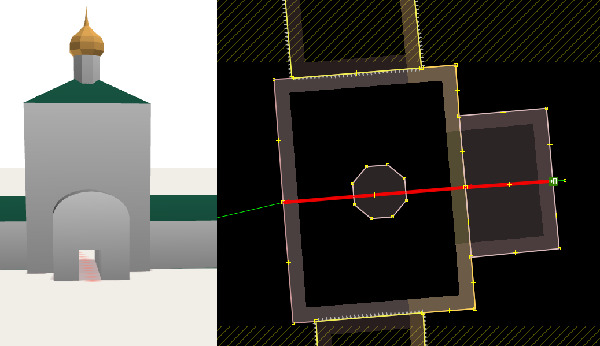
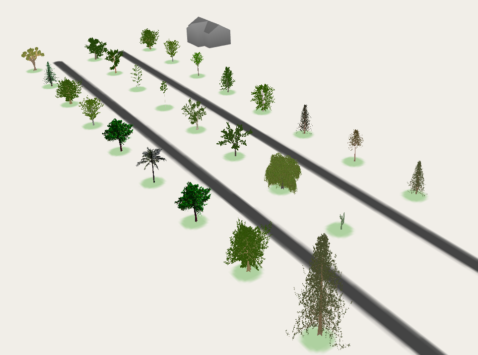

# v2.10.0 "Building Passages"

*This release adds one long-requested feature (passages through a building) and widens the variety of trees.*

## Support for the `tunnel=building_passage` tag

A road tagged [`tunnel=building_passage`](https://wiki.openstreetmap.org/wiki/Tag:tunnel%3Dbuilding_passage) now cuts a real opening through every building (or building part) it crosses, instead of the way simply disappearing inside the volume:

* The **width** of the opening follows the `width` tag, and otherwise the kind of the way — a footway gets a narrow opening, a residential road a wider one. `maxwidth` is used as a fallback.
* The **height** of the arch follows `tunnel:height`, `maxheight:physical`, `maxheight` and `height`. When none of them is present, the height of the first floor is used.

Originally requested as [issue #6](https://github.com/Zkir/UrbanEye3D/issues/6).

## Improved Trees: twenty new species textures

The plugin ships **23 tree textures instead of 3**, so trees are now rendered with a species-specific silhouette much more often than before:

* The plugin previously recognized 2,000 tree species, but the `species` tag was used only to determine the leaf type (`leaf_type`) and to select one of three standard models. Now, however, the `species` tag is also used to directly select a specific tree model, albeit in a limited capacity.

* The new tree models are generated using the **[SeedThree](https://github.com/SkyeShark/SeedThree)** library. It currently contains 20 tree presets; while that’s a far cry from the 2,000 required, it’s still better than nothing. Besides, as the saying goes, the first step is always the hardest.

* You can see which specific species have received custom textures in the new report: **[seedthree_coverage.md](../../seedthree_coverage.md)**.

* Growing that list means adding species presets upstream in SeedThree. This process doesn’t seem *too* difficult, so if you have some spare time and a love for trees, consider contributing to the project!

## Under the Hood

* **Data pipeline.** A new step has been added to our data preprocessing pipeline for the plugin: tree texture baking using the [SeedThree library](https://github.com/SkyeShark/SeedThree). It is used to bake 20 tree textures. 
    * Why **SeedThree**, specifically? It has the following advantages:
		* It’s an active open-source library with 121 stars on GitHub.
		* It features 20 biologically grounded procedural tree models. 
		* Crucially, these models correspond to specific species, identified by their binomial Latin names—exactly what we need to select the right texture based on a "species" tag.
		
	* Why do we use pre-baked textures instead of generating textures—or even individual polygonal models—for each tree within the plugin itself?
        * Primarily because SeedThree is written in JavaScript. Implementing such generation directly within the plugin would require porting it to Java. While such a port is theoretically possible—especially in the era of LLMs—it isn't worth the effort as long as the number of available models remains small.

---
The Urban Eye is watching you!
