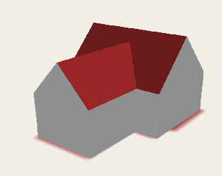
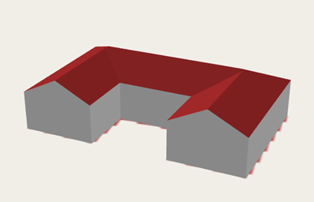
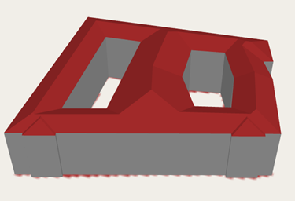
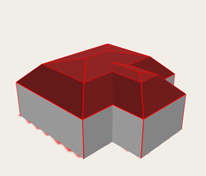
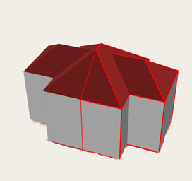
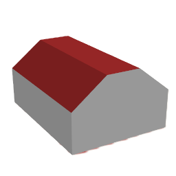
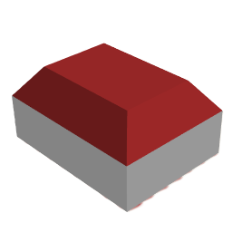
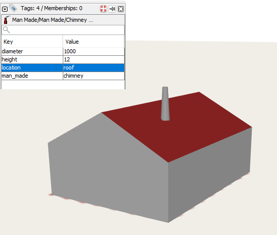

# v2.9.0 "Keeping up with the Joneses"

*This release is quite special: it does not include the improvements I wanted to implement.
Instead, it is primarily an attempt to catch up with Felis Pimeja's remarkable [OSM Simple3D Editor](https://felispimeja.github.io/osm-simple3d-editor).
The main addition is roof shapes, which were already available in Felis's tool but had been missing from UrbanEye3D.*

## Improved Roof Shapes
* The algorithm for constructing gabled roofs (`roof:shape=gabled`) has been completely reworked.
A gabled roof is created from a hipped roof by making the triangular faces vertical. 
This allows more natural roof shapes on complex ountlines, including non-convex ones, which are not easily achivable with parts!  

  

The old behavior is retained for the case when `roof:direction` or `roof:orientation` is specified explicitly. 
In such case the single straight ridge is generated (on non-quadrilateral outlines results can be strange). 

* `roof:shape=hipped` and `roof:shape=gabled` are now supported for building outlines with holes. 

A lot of such buildings in [Dresden](https://www.openstreetmap.org/relation/5789)!

* `roof:shape=mansard` is now supported for buildings with arbitrary outlines (even non-convex/with holes), not only quadrangular ones.  

* `roof:shape=side_hipped` is now supported for buildings with complex (non-convex) outlines, not only quadrangular ones.
Not very practical, but allows to model semi-detached houses like this: 

## New Roof Shapes
Two new "saltbox" variants are supported:
* `roof:shape=double_saltbox` — a symmetrical roof with two slopes on each side and a flat top.  
* `roof:shape=quadruple_saltbox` — the same idea extended to all four sides (a flat-topped hipped roof); works for arbitrary building outlines.  

	

I still think that **"quadruple saltbox"** is not the proper name of this roof shape, especially on arbitrary outlines. Something like `flat_mansard` or `capped_mansard` would be better.

## The `location=roof` tag
* The `location=roof` tag is now supported for node objects. The objects standing on a roof (chimneys, flagpoles, trees, etc.) are now placed on the roof of the building below them. 
If the object has no `min_height`, the plugin takes the height of the roof surface at that point and uses it as `min_height`, so such objects no longer sink into the building.
For sloped roofs the object follows the roof surface, and for buildings with multiple building parts it stands on the highest surface.

	

## Units of Measure 
* Units of measure (both metric and imperial) are now respected in dimension tags (height, roof:height, diameter, width e.t.c.). 
The following units are supported: 
    * `m`, `cm`, `mm`
	*  `ft`, `foot`, `feet`, `'`, `in`, `inch`, `inches`, `"`

Examples:
* `height=18m`, `width=10 ft`, `roof:height=9'4"`

Values without a unit are interpreted exactly as before: as meters, with the single exception of a `diameter` tag, which stays in millimeters per OSM convention.

---
The Urban Eye is watching you!
