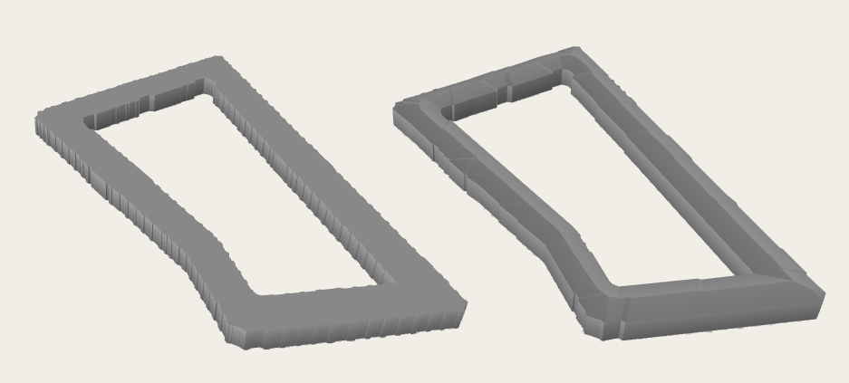

# v2.9.1 "November fixes"

*This is a patch release. It includes several important bugfixes.*

## Fixed Bugs

### Issue #72
* The nasty glitch with disappearing textures and trees rendered as white rectangles has hopefully been fixed.
    * At least it is no longer reproducible after the refactoring of texture processing.
    * Originally reported as [issue #72](https://github.com/Zkir/UrbanEye3D/issues/72)

### Issue #82
* The [building relation](https://wiki.openstreetmap.org/wiki/Relation:building) is now used, together with spatial checks, to determine which parts (`building:part=*`) belong to which buildings (`building=*`).
    * The relation has priority over the spatial check. This is helpful in complex cases, such as when a part extends beyond the building's footprint (e.g., an overhang) or when a single part lies within the footprints of several buildings.
	* The built-in validator follows the same rules, so it reports no false positives: parts explicitly linked to their outline via a `type=building` relation are not reported as orphaned, and outlines are not reported as insufficiently covered by parts when the relation assigns those parts.
	* Originally reported as [issue #82](https://github.com/Zkir/UrbanEye3D/issues/82)

<!-- TODO: add a screenshot of an L-shaped building with overhanging parts (before/after) -->

### Issue w/o number
* The 3D window no longer **freezes**, even for buildings with complex outlines and hipped or gabled roofs (and their variants).
    * Overly complex outlines are aggressively simplified — but only as much as needed.
    * If the simplification does not help, a flat roof is created, but the 3D window keeps repainting.

*Left: the original building with a flat roof. Right: the same building with a simplified outline and a proper hipped roof.*

## Documentation

*   New section [Buildings and Building Parts](../../features.md#buildings-and-building-parts) in [features.md](../../features.md): how parts are matched to buildings, what a part inherits from its building, and why `type=building` relations are justified only in exceptional cases.

## Under the Hood

*   **Offscreen rendering test.** A new autotest renders the whole scene (`city_center.osm`) offscreen and verifies that the result is a rich 3D image. This should help with a potential future refactoring of the plugin’s rendering engine.
*   **Small rendering optimization:** the `cos(latitude)` factor is computed once per frame instead of once per object.
*   **The campskeleton library patch:** the campskeleton library, which is used for the construction of hipped roofs, has been patched to react properly to thread interruption. The dependency is now the patched fork `0.0.1-PATCH-1`, published on GitHub Packages.

---
The Urban Eye is watching you!
