# OSM species vs [SeedThree](https://github.com/SkyeShark/SeedThree) coverage

Top 150 OSM species cover 81% of all 13566 species names in OSM tree data.
Of them 10 already have a SeedThree texture (weighted by occurrences: 4% of the top-150 tag occurrences).

## Top 150 OSM species

| # | species (OSM) | occurrences | SeedThree coverage | texture |
|---:|---|---:|---|---|
| 1 | Acer platanoides | 114662 | no |  |
| 2 | Quercus robur | 85552 | no |  |
| 3 | Tilia cordata | 75415 | no |  |
| 4 | Aesculus hippocastanum | 68168 | no |  |
| 5 | Tilia x europaea | 60915 | no |  |
| 6 | Platanus × hispanica | 53093 | no |  |
| 7 | Fraxinus excelsior | 50646 | no |  |
| 8 | Acer pseudoplatanus | 46397 | no |  |
| 9 | Juglans regia | 38273 | no |  |
| 10 | Olea europaea | 38239 | no |  |
| 11 | Carpinus betulus | 36598 | no |  |
| 12 | Robinia pseudoacacia | 34299 | no |  |
| 13 | Celtis australis | 32889 | no |  |
| 14 | Acer campestre | 29216 | no |  |
| 15 | Betula pendula | 28847 | no |  |
| 16 | Platanus x hispanica | 28803 | no |  |
| 17 | Tilia platyphyllos | 28194 | no |  |
| 18 | Gleditsia triacanthos | 23059 | no |  |
| 19 | Platanus acerifolia | 21321 | no |  |
| 20 | Tilia tomentosa | 20849 | no |  |
| 21 | Platanus x acerifolia | 20721 | no |  |
| 22 | Quercus rubra | 20230 | no |  |
| 23 | Acer saccharum | 19078 | no |  |
| 24 | Cocos nucifera | 18763 | no |  |
| 25 | Acer rubrum | 17135 | yes, exact (`redMaple`) |  |
| 26 | Acer saccharinum | 17037 | no |  |
| 27 | Populus nigra | 16437 | no |  |
| 28 | Prunus avium | 15728 | yes, exact (`cherry`) | 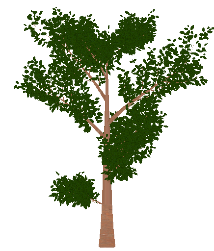 |
| 29 | Fagus sylvatica | 14789 | no |  |
| 30 | Cupressus sempervirens | 14316 | no |  |
| 31 | Ginkgo biloba | 14250 | no |  |
| 32 | Liquidambar styraciflua | 14014 | yes, exact (`sweetgum`) | 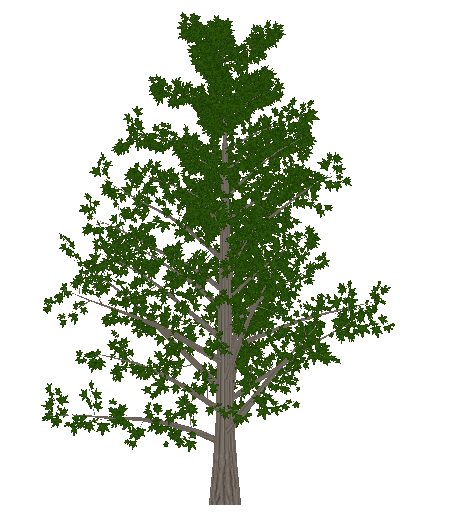 |
| 33 | Prunus cerasifera | 13724 | no |  |
| 34 | Quercus ilex | 13346 | no |  |
| 35 | Styphnolobium japonicum | 13232 | no |  |
| 36 | Acer negundo | 13135 | no |  |
| 37 | Corylus colurna | 12839 | no |  |
| 38 | Adansonia grandidieri | 12807 | no |  |
| 39 | Fraxinus americana | 12568 | no |  |
| 40 | Pinus pinea | 12384 | no |  |
| 41 | Pyrus calleryana | 12091 | no |  |
| 42 | Fraxinus pennsylvanica | 12081 | no |  |
| 43 | Bertholletia excelsa | 11960 | no |  |
| 44 | Prunus serrulata | 11448 | no |  |
| 45 | Pinus sylvestris | 11417 | no |  |
| 46 | Pinus nigra | 10705 | no |  |
| 47 | Picea pungens | 10015 | no |  |
| 48 | Phoenix canariensis | 9151 | no |  |
| 49 | Alnus glutinosa | 8496 | no |  |
| 50 | Castanea sativa | 8467 | no |  |
| 51 | Platanus orientalis | 8007 | no |  |
| 52 | Malus domestica | 7855 | yes, exact (`apple`) | 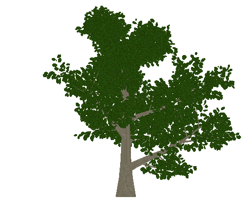 |
| 53 | Taxus baccata | 7717 | no |  |
| 54 | Populus alba | 7675 | no |  |
| 55 | Sorbus intermedia | 7531 | no |  |
| 56 | Picea abies | 7427 | no |  |
| 57 | Salix alba | 7355 | no |  |
| 58 | Syringa reticulata | 6920 | no |  |
| 59 | Sorbus aucuparia | 6841 | no |  |
| 60 | Fraxinus ornus | 6835 | no |  |
| 61 | Fraxinus angustifolia | 6810 | no |  |
| 62 | Liriodendron tulipifera | 6743 | yes, exact (`tulipPoplar`) | 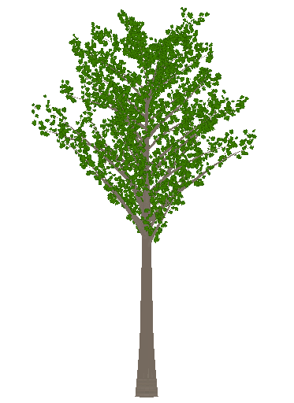 |
| 63 | Sophora japonica | 6533 | no |  |
| 64 | Quercus palustris | 6375 | no |  |
| 65 | Cercis siliquastrum | 6311 | no |  |
| 66 | Tilia × europaea | 6235 | no |  |
| 67 | Populus nigra 'Italica' | 6129 | no |  |
| 68 | Eucalyptus leucoxylon | 6016 | no |  |
| 69 | Picea glauca | 5996 | no |  |
| 70 | Platanus X hispanica | 5992 | no |  |
| 71 | Jubaea chilensis | 5902 | no |  |
| 72 | Quercus cerris | 5860 | no |  |
| 73 | Ulmus americana | 5389 | no |  |
| 74 | Sorbus aria | 5282 | no |  |
| 75 | Lagerstroemia indica | 5279 | no |  |
| 76 | Camphora officinarum | 5266 | no |  |
| 77 | Platanus acerifolia x | 5210 | no |  |
| 78 | Cerasus × yedoensis | 5208 | no |  |
| 79 | Phoenix dactylifera | 5202 | no |  |
| 80 | Catalpa bignonioides | 4900 | no |  |
| 81 | Ailanthus altissima | 4842 | no |  |
| 82 | Magnolia grandiflora | 4788 | no |  |
| 83 | Thuja occidentalis | 4666 | no |  |
| 84 | Washingtonia robusta | 4664 | no |  |
| 85 | Koelreuteria paniculata | 4627 | no |  |
| 86 | Morus alba | 4347 | no |  |
| 87 | Platanus ×hispanica | 4277 | no |  |
| 88 | Citrus × aurantium | 4246 | no |  |
| 89 | Zelkova serrata | 4193 | no |  |
| 90 | Crataegus monogyna | 4177 | no |  |
| 91 | Ulmus pumila | 4161 | no |  |
| 92 | Trachycarpus fortunei | 3978 | no |  |
| 93 | Melia azedarach | 3938 | no |  |
| 94 | Prunus domestica | 3926 | no |  |
| 95 | Eucalyptus camaldulensis | 3919 | no |  |
| 96 | Aesculus × carnea | 3896 | no |  |
| 97 | Cedrus atlantica | 3815 | no |  |
| 98 | Tilia euchlora x | 3682 | no |  |
| 99 | Cedrus deodara | 3604 | no |  |
| 100 | Melaleuca armillaris | 3593 | no |  |
| 101 | Pyrus communis | 3566 | no |  |
| 102 | Tilia americana | 3533 | no |  |
| 103 | Platanus occidentalis | 3511 | yes, exact (`americanSycamore`) | 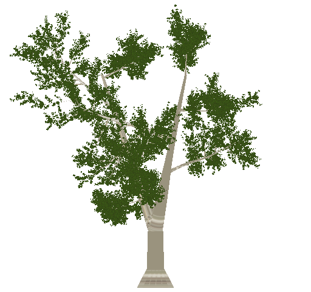 |
| 104 | Persea americana | 3476 | no |  |
| 105 | Chamaecyparis lawsoniana | 3399 | no |  |
| 106 | Quercus pubescens | 3280 | no |  |
| 107 | Tilia europaea | 3213 | no |  |
| 108 | Azadirachta indica | 3135 | no |  |
| 109 | Roystonea regia | 3121 | no |  |
| 110 | Juglans nigra | 3105 | no |  |
| 111 | Quercus petraea | 3085 | no |  |
| 112 | Quercus suber | 2991 | no |  |
| 113 | Callistemon viminalis | 2987 | no |  |
| 114 | Salix babylonica | 2935 | yes, exact (`weepingWillow`) | 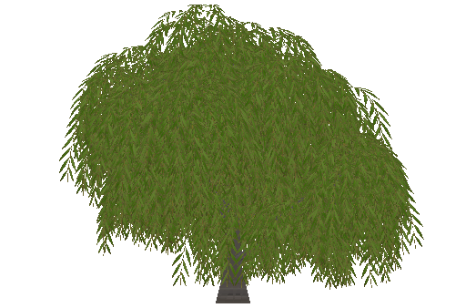 |
| 115 | Acer ginnala | 2927 | no |  |
| 116 | Alnus cordata | 2925 | no |  |
| 117 | Pinus strobus | 2835 | no |  |
| 118 | Lophostemon confertus | 2819 | no |  |
| 119 | Mangifera indica | 2813 | no |  |
| 120 | Tilia × euchlora | 2797 | no |  |
| 121 | Ulmus minor | 2793 | no |  |
| 122 | Aesculus x carnea | 2708 | no |  |
| 123 | Celtis occidentalis | 2691 | no |  |
| 124 | Corymbia maculata | 2649 | no |  |
| 125 | Jacaranda mimosifolia | 2585 | no |  |
| 126 | Sorbus domestica | 2575 | no |  |
| 127 | Ostrya carpinifolia | 2556 | no |  |
| 128 | Ilex aquifolium | 2484 | no |  |
| 129 | Ulmus glabra | 2480 | no |  |
| 130 | Crataegus laevigata | 2456 | no |  |
| 131 | Prunus padus | 2434 | no |  |
| 132 | Artocarpus altilis | 2405 | no |  |
| 133 | Pseudotsuga menziesii | 2381 | yes, exact (`douglasFir`) |  |
| 134 | Ilex rotunda | 2374 | no |  |
| 135 | Acacia raddiana | 2371 | no |  |
| 136 | Betula papyrifera | 2343 | yes, exact (`paperBirch`) | 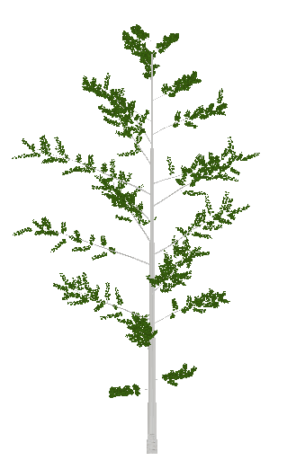 |
| 137 | Citrus aurantium | 2325 | no |  |
| 138 | Quercus macrocarpa | 2312 | no |  |
| 139 | Paulownia tomentosa | 2294 | no |  |
| 140 | Washingtonia filifera | 2286 | no |  |
| 141 | Sequoiadendron giganteum | 2211 | no |  |
| 142 | Quercus alba | 2190 | yes, exact (`whiteOak`) | 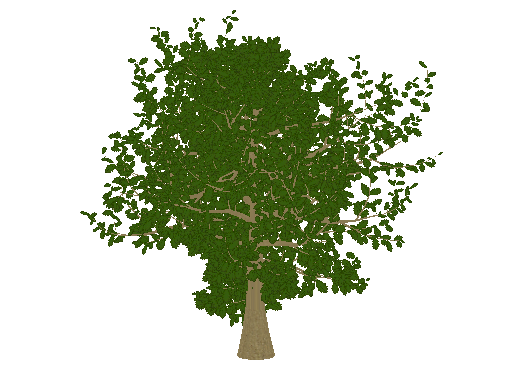 |
| 143 | Ligustrum japonicum | 2179 | no |  |
| 144 | Populus x canadensis | 2131 | no |  |
| 145 | Quercus bicolor | 2127 | no |  |
| 146 | Livistona chinensis | 2067 | no |  |
| 147 | Prunus cerasus | 2040 | no |  |
| 148 | Eucalyptus cladocalyx | 2034 | no |  |
| 149 | Morus nigra | 2033 | no |  |
| 150 | Populus tremula | 2011 | no |  |

## All SeedThree presets, by OSM occurrences

| # | Latin | OSM occurrences | preset | biome / foliage | MapCSS rule | texture |
|---:|---|---:|---|---|---|---|
| 1 | Acer rubrum | 17995 | `redMaple` | temperate / leaves | yes |  |
| 2 | Prunus avium | 17051 | `cherry` | temperate / leaves | yes |  |
| 3 | Liquidambar styraciflua | 14421 | `sweetgum` | temperate / leaves | yes |  |
| 4 | Malus domestica | 9130 | `apple` | temperate / leaves | yes |  |
| 5 | Liriodendron tulipifera | 6813 | `tulipPoplar` | temperate / leaves | yes |  |
| 6 | Salix babylonica | 3610 | `weepingWillow` | temperate / leaves | yes |  |
| 7 | Platanus occidentalis | 3511 | `americanSycamore` | temperate / leaves | yes |  |
| 8 | Pseudotsuga menziesii | 2462 | `douglasFir` | temperate / leaves | yes |  |
| 9 | Betula papyrifera | 2343 | `paperBirch` | temperate / leaves | yes |  |
| 10 | Quercus alba | 2201 | `whiteOak` | temperate / leaves | yes |  |
| 11 | Populus tremuloides | 1178 | `quakingAspen` | temperate / leaves | yes |  |
| 12 | Cornus florida | 734 | `floweringDogwood` | temperate / leaves | yes |  |
| 13 | Pinus taeda | 488 | `loblolly` | temperate / leaves | yes | 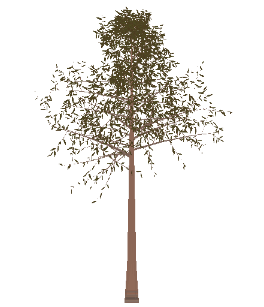 |
| 14 | Fagus grandifolia | 197 | `americanBeech` | temperate / leaves | yes | 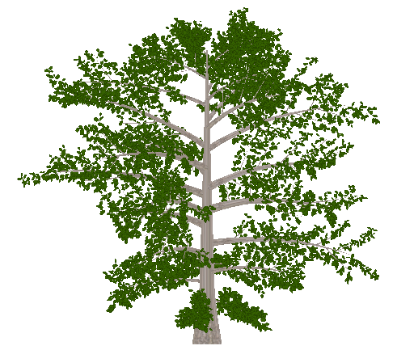 |
| 15 | Pinus ponderosa | 197 | `pine` | temperate / leaves | yes | 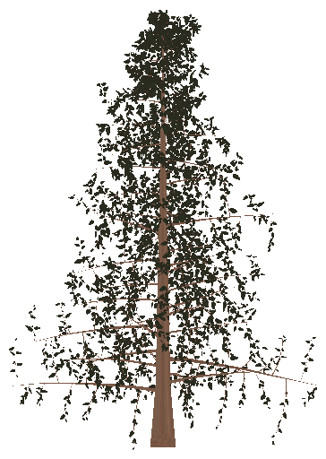 |
| 16 | Carnegiea gigantea | 24 | `saguaro` | desert / rosette | yes | 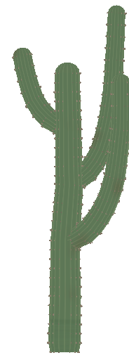 |
| 17 | Yucca brevifolia | 17 | `joshuaTree` | desert / rosette | yes |  |
| 18 | Larrea tridentata | 0 | `creosote` | desert / sprayClusters | no (not in tree_species.csv) |  |
| 19 | Coleogyne ramosissima | 0 | `blackbrush` | desert / sprayClusters | no (not in tree_species.csv) |  |
| 20 | Artemisia tridentata | 0 | `sagebrush` | desert / sprayClusters | no (not in tree_species.csv) | 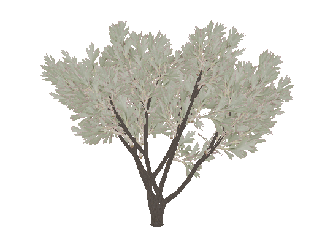 |

