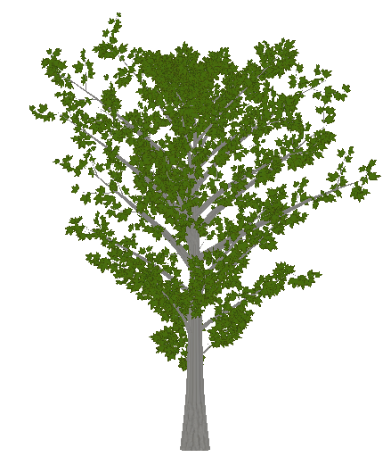
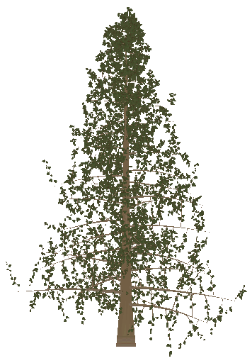
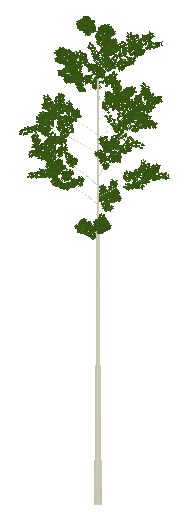
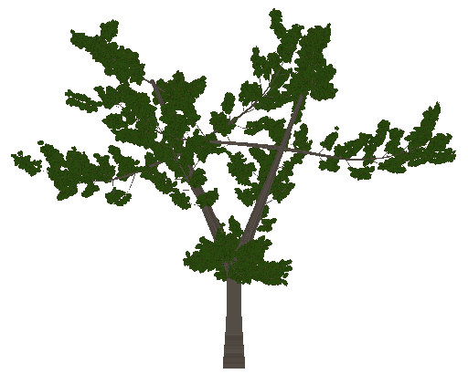
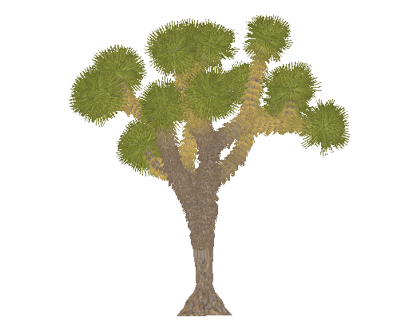
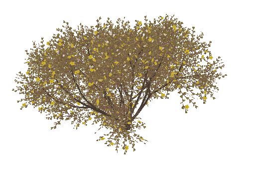
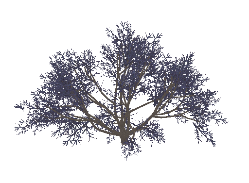

# OSM species vs [SeedThree](https://github.com/SkyeShark/SeedThree) coverage

Top 150 OSM species cover 81% of all 13669 species names in OSM tree data.
Of them 10 already have a SeedThree texture (weighted by occurrences: 4% of the top-150 tag occurrences).

## Top 150 OSM species

| # | species (OSM) | occurrences | SeedThree coverage | texture |
|---:|---|---:|---|---|
| 1 | Acer platanoides | 112252 | no |  |
| 2 | Quercus robur | 84802 | no |  |
| 3 | Tilia cordata | 75048 | no |  |
| 4 | Aesculus hippocastanum | 68069 | no |  |
| 5 | Tilia x europaea | 60777 | no |  |
| 6 | Platanus × hispanica | 52030 | no |  |
| 7 | Fraxinus excelsior | 50543 | no |  |
| 8 | Acer pseudoplatanus | 46278 | no |  |
| 9 | Juglans regia | 38233 | no |  |
| 10 | Olea europaea | 37472 | no |  |
| 11 | Carpinus betulus | 36454 | no |  |
| 12 | Robinia pseudoacacia | 34175 | no |  |
| 13 | Celtis australis | 32851 | no |  |
| 14 | Acer campestre | 29160 | no |  |
| 15 | Platanus x hispanica | 28806 | no |  |
| 16 | Betula pendula | 28803 | no |  |
| 17 | Tilia platyphyllos | 27899 | no |  |
| 18 | Gleditsia triacanthos | 23035 | no |  |
| 19 | Platanus acerifolia | 21320 | no |  |
| 20 | Tilia tomentosa | 20842 | no |  |
| 21 | Platanus x acerifolia | 20792 | no |  |
| 22 | Castanea sativa | 20399 | no |  |
| 23 | Quercus rubra | 20088 | no |  |
| 24 | Acer saccharum | 19076 | no |  |
| 25 | Cocos nucifera | 18747 | no |  |
| 26 | Acer rubrum | 17132 | yes, exact (`redMaple`) |  |
| 27 | Acer saccharinum | 17021 | no |  |
| 28 | Populus nigra | 16476 | no |  |
| 29 | Prunus avium | 15722 | yes, exact (`cherry`) |  |
| 30 | Fagus sylvatica | 14667 | no |  |
| 31 | Cupressus sempervirens | 14224 | no |  |
| 32 | Ginkgo biloba | 14072 | no |  |
| 33 | Liquidambar styraciflua | 13973 | yes, exact (`sweetgum`) |  |
| 34 | Prunus cerasifera | 13714 | no |  |
| 35 | Quercus ilex | 13246 | no |  |
| 36 | Acer negundo | 13121 | no |  |
| 37 | Styphnolobium japonicum | 13030 | no |  |
| 38 | Corylus colurna | 12829 | no |  |
| 39 | Adansonia grandidieri | 12807 | no |  |
| 40 | Fraxinus americana | 12568 | no |  |
| 41 | Pinus pinea | 12381 | no |  |
| 42 | Pyrus calleryana | 12080 | no |  |
| 43 | Fraxinus pennsylvanica | 12079 | no |  |
| 44 | Prunus serrulata | 11671 | no |  |
| 45 | Pinus sylvestris | 11370 | no |  |
| 46 | Pinus nigra | 10694 | no |  |
| 47 | Picea pungens | 10008 | no |  |
| 48 | Phoenix canariensis | 9122 | no |  |
| 49 | Alnus glutinosa | 8470 | no |  |
| 50 | Platanus orientalis | 8005 | no |  |
| 51 | Malus domestica | 7814 | yes, exact (`apple`) |  |
| 52 | Taxus baccata | 7672 | no |  |
| 53 | Populus alba | 7664 | no |  |
| 54 | Sorbus intermedia | 7496 | no |  |
| 55 | Picea abies | 7403 | no |  |
| 56 | Salix alba | 7351 | no |  |
| 57 | Syringa reticulata | 6915 | no |  |
| 58 | Sorbus aucuparia | 6834 | no |  |
| 59 | Fraxinus ornus | 6834 | no |  |
| 60 | Fraxinus angustifolia | 6813 | no |  |
| 61 | Liriodendron tulipifera | 6725 | yes, exact (`tulipPoplar`) |  |
| 62 | Sophora japonica | 6536 | no |  |
| 63 | Quercus palustris | 6370 | no |  |
| 64 | Cercis siliquastrum | 6266 | no |  |
| 65 | Tilia × europaea | 6218 | no |  |
| 66 | Populus nigra 'Italica' | 6129 | no |  |
| 67 | Eucalyptus leucoxylon | 6010 | no |  |
| 68 | Picea glauca | 5996 | no |  |
| 69 | Platanus X hispanica | 5993 | no |  |
| 70 | Jubaea chilensis | 5912 | no |  |
| 71 | Quercus cerris | 5857 | no |  |
| 72 | Platanus acerifolia x | 5774 | no |  |
| 73 | Phoenix dactylifera | 5439 | no |  |
| 74 | Ulmus americana | 5368 | no |  |
| 75 | Sorbus aria | 5306 | no |  |
| 76 | Camphora officinarum | 5266 | no |  |
| 77 | Lagerstroemia indica | 5221 | no |  |
| 78 | Cerasus × yedoensis | 5208 | no |  |
| 79 | Catalpa bignonioides | 4895 | no |  |
| 80 | Ailanthus altissima | 4847 | no |  |
| 81 | Magnolia grandiflora | 4780 | no |  |
| 82 | Koelreuteria paniculata | 4623 | no |  |
| 83 | Thuja occidentalis | 4555 | no |  |
| 84 | Washingtonia robusta | 4378 | no |  |
| 85 | Morus alba | 4328 | no |  |
| 86 | Platanus ×hispanica | 4236 | no |  |
| 87 | Citrus × aurantium | 4212 | no |  |
| 88 | Zelkova serrata | 4181 | no |  |
| 89 | Crataegus monogyna | 4175 | no |  |
| 90 | Ulmus pumila | 4158 | no |  |
| 91 | Trachycarpus fortunei | 3972 | no |  |
| 92 | Prunus domestica | 3918 | no |  |
| 93 | Eucalyptus camaldulensis | 3914 | no |  |
| 94 | Melia azedarach | 3884 | no |  |
| 95 | Aesculus × carnea | 3795 | no |  |
| 96 | Cedrus atlantica | 3720 | no |  |
| 97 | Tilia euchlora x | 3686 | no |  |
| 98 | Cedrus deodara | 3594 | no |  |
| 99 | Melaleuca armillaris | 3593 | no |  |
| 100 | Pyrus communis | 3532 | no |  |
| 101 | Tilia americana | 3525 | no |  |
| 102 | Platanus occidentalis | 3509 | yes, exact (`americanSycamore`) |  |
| 103 | Persea americana | 3476 | no |  |
| 104 | Chamaecyparis lawsoniana | 3356 | no |  |
| 105 | Quercus pubescens | 3275 | no |  |
| 106 | Tilia europaea | 3213 | no |  |
| 107 | Roystonea regia | 3121 | no |  |
| 108 | Juglans nigra | 3099 | no |  |
| 109 | Quercus petraea | 3053 | no |  |
| 110 | Quercus suber | 2990 | no |  |
| 111 | Callistemon viminalis | 2987 | no |  |
| 112 | Acer ginnala | 2927 | no |  |
| 113 | Salix babylonica | 2925 | yes, exact (`weepingWillow`) |  |
| 114 | Alnus cordata | 2923 | no |  |
| 115 | Azadirachta indica | 2856 | no |  |
| 116 | Lophostemon confertus | 2819 | no |  |
| 117 | Mangifera indica | 2813 | no |  |
| 118 | Pinus strobus | 2808 | no |  |
| 119 | Tilia × euchlora | 2784 | no |  |
| 120 | Ulmus minor | 2779 | no |  |
| 121 | Aesculus x carnea | 2719 | no |  |
| 122 | Celtis occidentalis | 2690 | no |  |
| 123 | Corymbia maculata | 2650 | no |  |
| 124 | Jacaranda mimosifolia | 2584 | no |  |
| 125 | Ostrya carpinifolia | 2553 | no |  |
| 126 | Ilex aquifolium | 2474 | no |  |
| 127 | Crataegus laevigata | 2447 | no |  |
| 128 | Ulmus glabra | 2446 | no |  |
| 129 | Prunus padus | 2433 | no |  |
| 130 | Sorbus domestica | 2429 | no |  |
| 131 | Artocarpus altilis | 2405 | no |  |
| 132 | Ilex rotunda | 2371 | no |  |
| 133 | Pseudotsuga menziesii | 2367 | yes, exact (`douglasFir`) |  |
| 134 | Betula papyrifera | 2343 | yes, exact (`paperBirch`) |  |
| 135 | Citrus aurantium | 2325 | no |  |
| 136 | Quercus macrocarpa | 2311 | no |  |
| 137 | Paulownia tomentosa | 2291 | no |  |
| 138 | Washingtonia filifera | 2221 | no |  |
| 139 | Quercus alba | 2190 | yes, exact (`whiteOak`) |  |
| 140 | Ligustrum japonicum | 2178 | no |  |
| 141 | Acacia raddiana | 2134 | no |  |
| 142 | Populus x canadensis | 2130 | no |  |
| 143 | Quercus bicolor | 2124 | no |  |
| 144 | Sequoiadendron giganteum | 2075 | no |  |
| 145 | Livistona chinensis | 2057 | no |  |
| 146 | Prunus cerasus | 2037 | no |  |
| 147 | Eucalyptus cladocalyx | 2034 | no |  |
| 148 | Morus nigra | 2032 | no |  |
| 149 | Populus tremula | 2008 | no |  |
| 150 | Tilia x euchlora | 1989 | no |  |

## All SeedThree presets, by OSM occurrences

| # | Latin | OSM occurrences | preset | biome / foliage | MapCSS rule | texture |
|---:|---|---:|---|---|---|---|
| 1 | Acer rubrum | 17992 | `redMaple` | temperate / leaves | yes |  |
| 2 | Prunus avium | 17045 | `cherry` | temperate / leaves | yes |  |
| 3 | Liquidambar styraciflua | 14380 | `sweetgum` | temperate / leaves | yes |  |
| 4 | Malus domestica | 9081 | `apple` | temperate / leaves | yes |  |
| 5 | Liriodendron tulipifera | 6799 | `tulipPoplar` | temperate / leaves | yes |  |
| 6 | Salix babylonica | 3600 | `weepingWillow` | temperate / leaves | yes |  |
| 7 | Platanus occidentalis | 3509 | `americanSycamore` | temperate / leaves | yes |  |
| 8 | Pseudotsuga menziesii | 2449 | `douglasFir` | temperate / leaves | yes |  |
| 9 | Betula papyrifera | 2343 | `paperBirch` | temperate / leaves | yes |  |
| 10 | Quercus alba | 2201 | `whiteOak` | temperate / leaves | yes |  |
| 11 | Populus tremuloides | 1178 | `quakingAspen` | temperate / leaves | yes |  |
| 12 | Cornus florida | 733 | `floweringDogwood` | temperate / leaves | yes |  |
| 13 | Pinus taeda | 488 | `loblolly` | temperate / leaves | yes |  |
| 14 | Fagus grandifolia | 197 | `americanBeech` | temperate / leaves | yes |  |
| 15 | Pinus ponderosa | 197 | `pine` | temperate / leaves | yes |  |
| 16 | Carnegiea gigantea | 24 | `saguaro` | desert / rosette | yes |  |
| 17 | Yucca brevifolia | 17 | `joshuaTree` | desert / rosette | yes |  |
| 18 | Larrea tridentata | 0 | `creosote` | desert / sprayClusters | no (not in tree_species.csv) |  |
| 19 | Coleogyne ramosissima | 0 | `blackbrush` | desert / sprayClusters | no (not in tree_species.csv) |  |
| 20 | Artemisia tridentata | 0 | `sagebrush` | desert / sprayClusters | no (not in tree_species.csv) |  |

